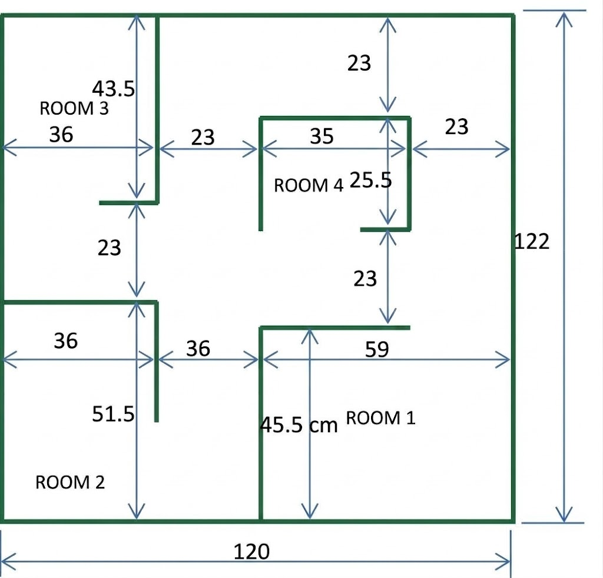

# Spesifikasi & Layout Arena UTS — Simulasi Robotika

Dokumen ini merupakan konversi dan dokumentasi teknis dari `arena uts.docx`. Arena ini dirancang untuk simulasi robot mobile (*E-puck*) pada lingkungan Webots, mengadopsi model labirin standar **Trinity College Fire-Fighting Home Robot Contest** / **Kontes Robot Pemadam Api Indonesia (KRPAI)** dengan **skala 1:2 (skala 50%)**.

---

## 1. Denah & Blueprint Arena

> **Catatan Skala:**
> Arena standar kompetisi berukuran $244\text{ cm} \times 244\text{ cm}$ ($8\text{ ft} \times 8\text{ ft}$) dengan lebar lorong $46\text{ cm}$. Arena UTS ini diskalakan setengahnya ($1:2$) menjadi **$120\text{ cm} \times 122\text{ cm}$** dengan lebar lorong dan pintu standar **$23\text{ cm}$**.

---

## 2. Dimensi Utama (Global Bounds)

| Parameter | Nilai (cm) | Nilai Webots (m) | Keterangan |
| :--- | :--- | :--- | :--- |
| **Lebar Arena ($X$)** | $120.0\text{ cm}$ | $1.20\text{ m}$ | Sumbu horizontal total |
| **Panjang Arena ($Y$)** | $122.0\text{ cm}$ | $1.22\text{ m}$ | Sumbu vertikal total |
| **Lebar Lorong Standar** | $23.0\text{ cm}$ | $0.23\text{ m}$ | Clearance antar-dinding di seluruh koridor |
| **Lebar Pintu / Akses Masuk** | $23.0\text{ cm}$ | $0.23\text{ m}$ | Bukaan masuk ke setiap ruangan |
| **Tinggi Dinding (Rekomendasi)** | $15.0 - 20.0\text{ cm}$ | $0.15 - 0.20\text{ m}$ | Ideal untuk sensor inframerah & kamera E-puck |
| **Tebal Dinding (Rekomendasi)** | $1.0 - 1.5\text{ cm}$ | $0.010 - 0.015\text{ m}$ | Ketebalan sekat pembatas arena |

---

## 3. Rincian Ruangan (Room Breakdown)

Arena terbagi menjadi 4 ruangan (ROOM 1 s.d. ROOM 4) yang terhubung oleh koridor labirin:

### ROOM 1 (Ruang 1 — Tenggara / Kanan Bawah)
* **Letak**: Sudut kanan bawah arena.
* **Dinding Barat (Vertikal)**:
  * Menempel dari dinding batas bawah arena membentang ke atas setinggi **$45.5\text{ cm}$**.
  * Berjarak **$59.0\text{ cm}$** dari dinding batas kanan arena (atau sekitar $61.0\text{ cm}$ dari dinding batas kiri).
* **Dinding Utara (Horizontal)**:
  * Membentang ke kanan dari puncak dinding barat setinggi $y = 45.5\text{ cm}$.
  * Panjang segmen: **$36.0\text{ cm}$**, berhenti lurus sejajar dengan sisi timur Room 4.
  * Menyisakan bukaan pintu masuk selebar **$23.0\text{ cm}$** menuju dinding batas kanan arena.
* **Pintu Akses Masuk**: Bukaan di sisi timur laut ruangan selebar **$23.0\text{ cm}$**.

### ROOM 2 (Ruang 2 — Barat Daya / Kiri Bawah)
* **Letak**: Sudut kiri bawah arena.
* **Dinding Utara (Horizontal)**:
  * Menempel dari dinding batas kiri arena membentang ke arah timur sepanjang **$36.0\text{ cm}$**.
  * Terletak pada ketinggian **$51.5\text{ cm}$** dari dinding batas bawah arena.
* **Dinding Timur (Vertikal / Sekat Masuk)**:
  * Terpasang di ujung timur dinding horizontal ($x = 36.0\text{ cm}$), menjulur ke bawah ke arah dalam ruangan.
* **Pintu Akses Masuk & Lorong**:
  * Pintu masuk berada di sisi atas ruangan melalui koridor barat.
  * Jarak koridor vertikal antara Room 2 dan Room 3 di atasnya: **$23.0\text{ cm}$**.
  * Jarak lorong horizontal dari sekat Room 2 menuju dinding barat Room 1: **$36.0\text{ cm}$**.

### ROOM 3 (Ruang 3 — Barat Laut / Kiri Atas)
* **Letak**: Sudut kiri atas arena.
* **Dinding Timur (Vertikal)**:
  * Menempel dari dinding batas atas arena membentang ke bawah sepanjang **$43.5\text{ cm}$**.
  * Berjarak **$36.0\text{ cm}$** dari dinding batas kiri arena.
* **Dinding Selatan (Horizontal / Sekat Masuk)**:
  * Menjulur ke arah kiri (ke arah dalam Room 3) dari ujung bawah dinding vertikal.
* **Pintu Akses Masuk & Lorong**:
  * Celah pintu masuk ruangan selebar **$23.0\text{ cm}$** menuju koridor tengah/barat.
  * Lebar koridor antara sisi timur Room 3 menuju dinding barat Room 4: **$23.0\text{ cm}$**.

### ROOM 4 (Ruang 4 — Tengah Atas / Ruang Pulau)
* **Letak**: Ruang pulau (*island room*) di bagian tengah-atas arena yang dikelilingi koridor.
* **Dimensi Ruangan**:
  * **Dinding Utara (Horizontal)**: Panjang **$35.0\text{ cm}$**.
  * **Dinding Barat (Vertikal)**: Menjulur ke bawah dari ujung kiri dinding utara.
  * **Dinding Timur (Vertikal)**: Panjang **$25.5\text{ cm}$** menjulur ke bawah dari ujung kanan dinding utara.
  * **Dinding Selatan (Horizontal)**: Menjulur ke kiri dari ujung bawah dinding timur.
* **Jarak Clearance Koridor di Sekeliling Room 4**:
  * Jarak ke dinding atas arena: **$23.0\text{ cm}$**.
  * Jarak ke dinding kanan arena: **$23.0\text{ cm}$**.
  * Jarak ke dinding timur Room 3: **$23.0\text{ cm}$**.
  * Jarak ke dinding utara Room 1: **$23.0\text{ cm}$**.
* **Pintu Akses Masuk**: Bukaan di sisi barat daya ruangan (antara ujung dinding selatan dan dinding barat).

---

## 4. Panduan Implementasi di Webots (World Setup)

### A. Sistem Koordinat Webots
Pada Webots (prototipe arena menggunakan sumbu $X$ horizontal dan $Y$ vertikal dengan $Z$ sebagai ketinggian):
* **Pusat Koordinat Arena (Origin $(0,0)$)**: Titik tengah lantai arena.
  * Batas $X$: $[-0.60\text{ m}, +0.60\text{ m}]$ (total $1.20\text{ m}$)
  * Batas $Y$: $[-0.61\text{ m}, +0.61\text{ m}]$ (total $1.22\text{ m}$)
  * Elevasi Lantai: $Z = 0.0\text{ m}$

### B. Konversi Koordinat Sudut ke Titik Tengah Webots ($X_{Webots}, Y_{Webots}$)
Jika titik acuan $(0,0)$ pada gambar blueprint dihitung dari **sudut kiri-bawah**:
$$\begin{aligned}
X_{Webots} &= X_{cm} / 100.0 - 0.60 \\
Y_{Webots} &= Y_{cm} / 100.0 - 0.61
\end{aligned}$$

| Komponen Dinding | Koordinat Awal (cm) | Koordinat Akhir (cm) | Panjang (m) | Posisi Pusat $(X, Y)$ Webots (m) |
| :--- | :--- | :--- | :--- | :--- |
| **Batas Luar Bawah** | $(0, 0)$ | $(120, 0)$ | $1.20$ | $(0.0, -0.61)$ |
| **Batas Luar Atas** | $(0, 122)$ | $(120, 122)$ | $1.20$ | $(0.0, +0.61)$ |
| **Batas Luar Kiri** | $(0, 0)$ | $(0, 122)$ | $1.22$ | $(-0.60, 0.0)$ |
| **Batas Luar Kanan** | $(120, 0)$ | $(120, 122)$ | $1.22$ | $(+0.60, 0.0)$ |
| **Room 1: Dinding Barat** | $(61, 0)$ | $(61, 45.5)$ | $0.455$ | $(+0.01, -0.3825)$ |
| **Room 1: Dinding Utara** | $(61, 45.5)$ | $(97, 45.5)$ | $0.360$ | $(+0.19, -0.155)$ |
| **Room 2: Dinding Utara** | $(0, 51.5)$ | $(36, 51.5)$ | $0.360$ | $(-0.42, -0.095)$ |
| **Room 2: Dinding Timur** | $(36, 26.5)$ | $(36, 51.5)$ | $0.250$ | $(-0.24, -0.22)$ |
| **Room 3: Dinding Timur** | $(36, 78.5)$ | $(36, 122)$ | $0.435$ | $(-0.24, +0.3925)$ |
| **Room 3: Dinding Selatan**| $(20, 78.5)$ | $(36, 78.5)$ | $0.160$ | $(-0.32, +0.175)$ |
| **Room 4: Dinding Utara** | $(62, 99)$ | $(97, 99)$ | $0.350$ | $(+0.195, +0.38)$ |
| **Room 4: Dinding Barat** | $(62, 73.5)$ | $(62, 99)$ | $0.255$ | $(+0.02, +0.2525)$ |
| **Room 4: Dinding Timur** | $(97, 73.5)$ | $(97, 99)$ | $0.255$ | $(+0.37, +0.2525)$ |
| **Room 4: Dinding Selatan**| $(82, 73.5)$ | $(97, 73.5)$ | $0.150$ | $(+0.295, +0.125)$ |

---

## 5. Pertimbangan Navigasi Robot E-puck

1. **Rasio Ukuran Robot vs Lorong**:
   * Diameter bodi E-puck: $\approx 7.4\text{ cm}$ ($0.074\text{ m}$).
   * Lebar lorong: $23.0\text{ cm}$ ($0.23\text{ m}$).
   * Ruang bebas (clearance) tersisa saat berada di tengah: $\approx 7.8\text{ cm}$ di sisi kiri dan kanan.
2. **Konfigurasi Sensor Jarak Inframerah**:
   * Sensor sudut depan (`ps0` di kanan depan, `ps7` di kiri depan) untuk mendeteksi dinding depan pada jarak $\approx 6 - 8\text{ cm}$ (nilai ADC $> 80 - 120$).
   * Sensor samping (`ps2` di kanan, `ps5` di kiri) untuk penelusuran dinding (*wall following*).
3. **Strategi Navigasi**:
   * **Wall-Following**: Baik *Right-Wall Follower* maupun *Left-Wall Follower* dapat menelusuri seluruh ruangan dan kembali ke titik asal.
   * **Deteksi Target**: Jika arena menggunakan lilin / target berwarna merah di dalam ruangan, gunakan kamera robot (`camera`) dengan filter piksel merah atau sensor cahaya (`ls0` - `ls7`) seperti yang telah diimplementasikan pada `controller_robot_sensor_4.c`.

